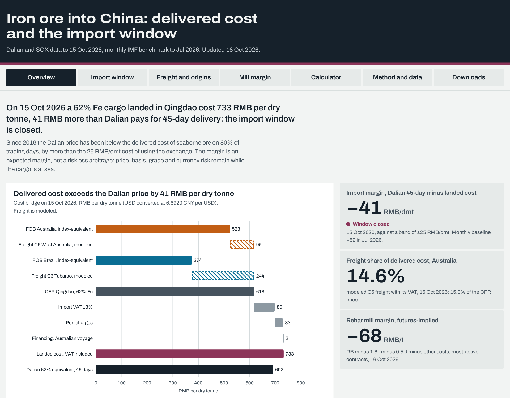

# Iron ore into China: delivered cost and the import window

**Live site: https://nathancouturier.github.io/iron-ore-china-arbitrage/**
Research note (PDF): [`Iron-Ore-China-Import-Arbitrage-Research-Note.pdf`](site/downloads/Iron-Ore-China-Import-Arbitrage-Research-Note.pdf)



## The question

China imported 1,258.71 Mt of iron ore in 2025 and 1,236.55 Mt in 2024 (China Customs year totals), about three quarters of the world's seaborne trade by ship-tracking estimates ([Signal Ocean](https://www.thesignalgroup.com/newsroom/annual-review-2025-commodities-geopolitical-risk): 75% in 2025). The project answers one practical question: **when does it pay to bring a cargo of seaborne iron ore into China, from where, and who captures the margin between the mine and the blast furnace?**

It traces the delivered cost of a 62% Fe cargo along the voyage: the index-equivalent FOB netback in Australia or Brazil (the 62% CFR China price minus modeled Capesize freight on C5 or C3), CFR Qingdao, then USD/CNY, import VAT, port charges and voyage financing to the landed cost, which is compared with the Dalian futures price for the matching delivery. Downstream, the futures-implied steel mill margin shows whether mills can keep paying for that ore.

## The answer (data to 15 October 2026)

- **The window is closed, and it almost always has been.** On 15 Oct 2026 a West Australian cargo bought for delivery to Qingdao in about 45 days cost 733 RMB per dry tonne landed, VAT included, against 692 for 45-day Dalian delivery (margin −41 RMB/dmt, 16 beyond the band; without the 2.45 USD lift that puts 2026 SGX prices on a 62% Fe basis it would be −22, inside the band). Since December 2015 the margin cleared the 25 RMB/dmt cost of using the exchange on 0.9% of trading days, never for more than six days in a row; on the monthly baseline (January 2014 to July 2026) it sat below the band in 97% of months and averaged −80 RMB/dmt, 9.7% of landed cost.
- **The discount sits in the futures, not in the physical market.** On five dated Fastmarkets Qingdao port prices, Dalian's 45-day price was 72 to 374 RMB/dmt below the port price of 62% fines, while our landed cost reproduces Fastmarkets' own port-to-seaborne conversion within 1.5 USD/dmt. Freight takes 8.9% of the CFR price from West Australia and 21.2% from Brazil on average since 2014 (12.6% and 31.7% in 2026, the highest annual shares in the sample), so Brazil's index-equivalent netback trails Australia's by 11.9 USD/dmt on average and by 21.4 in July 2026.
- **Mills are squeezed, but that has not pushed ore down.** The rebar futures margin was −68 RMB/t on 16 Oct 2026 and negative on every trading day of 2026. The pre-registered test finds no sign that a bottom-decile mill margin precedes weaker Dalian ore: +5.9 percentage points over three months (95% interval −1.0 to +13.1), the opposite sign to the hypothesis.

The import margin is an expected margin, not a riskless arbitrage: price, basis, grade and currency risk remain while the cargo is at sea, and Dalian or SGX hedges reduce but do not remove them.

## Method

| Step | Convention |
|---|---|
| Seaborne price | 62% Fe CFR China, USD per dry tonne. Monthly baseline: IMF via FRED `PIORECRUSDM`. Daily series: SGX iron ore futures interpolated to a 45-day horizon (the current-month contract is excluded because it settles on the month's average); 2026 contracts settle on Platts IODEX at 61% Fe and are lifted to 62% by the measured monthly spread. |
| Freight | Modeled C3 and C5 (route rates are paid data): a voyage model fed by the Baltic Capesize Index (calibrated to the time charter average by regime on 62 dated public pairs) and Brent (bunker price calibrated before and after IMO 2020), at the Baltic eco speed of 12 knots over searoute distances. Converted to dry tonnes with 8% moisture. |
| Landed cost | CFR x USD/CNY x (1 + VAT) + port charges / (1 − moisture) + financing x USD/CNY. VAT 17%, 16% from 1 May 2018, 13% from 1 April 2019; duty zero. Port charges 30 RMB per wet tonne. Financing at SOFR (fed funds before April 2018) plus 150 bp for the laden voyage plus 10 days. |
| Dalian | Every iron ore contract, on a 62% Fe basis (standard grade 61% from I2205, plus 10 x X with X computed from the exchange rule: 1.5 RMB per 0.1% Fe in every period), interpolated to a constant 45-day maturity across contracts with at least 1,700 lots of open interest. 30, 60, 90 days and the most-active contract shown for comparison. |
| Margin and band | Margin = Dalian 45-day 62% equivalent minus landed cost. Window open above +25 RMB/dmt (delivery fee, about a month of storage and the vessel outbound fee cap). The daily series compares forward with forward (SGX and Dalian at 45 days, the hedgeable trade); the monthly baseline compares the spot index average with 45-day Dalian, so it shows a deeper discount in steep backwardation (2021). |
| Statistics | AR(1) half-life with a recursive residual bootstrap, ADF test, sensitivity tornado; mill test with a moving block bootstrap and Newey-West errors; imports test (year-on-year import growth over the next one to three months on the monthly margin, Newey-West errors). Both tests designed before computing. All in numpy (`ironarb/stats.py`). |
| Mill margin | Rebar (or HRC) − 1.6 x iron ore − 0.5 x coke − 1,080 RMB/t of other costs (HRC 150 more), a broker convention checked against SDIC Essence and Everbright Futures. |

Key results: monthly half-life 5.0 months (95% interval 2.3 to 8.2) but the ADF test cannot reject a unit root (p = 0.16), so the evidence for convergence on monthly data is weak; on daily data the half-life is 23 trading days (ADF p = 0.010). Three largest episodes, with primary sources: March 2022 (−366 RMB/dmt; NDRC curbs on iron ore speculation while seaborne supply tightened), July 2021 (−344; China's 2021 crude steel output cut), May 2016 (+59, but an artifact of the expiring May contract during a futures rally that led Dalian to raise iron ore fees and margins). Imports test (pre-registered): a margin 50 RMB/dmt higher precedes 3.1 percentage points faster year-on-year import growth over the next three months (95% interval 2.3 to 3.9, 87 months from December 2018), but the link rests on 2021 and 2022, when policy pushed Dalian far below import parity while imports fell; without those years the slope is 2.5 with an interval from −3.2 to +8.1 (exploratory check).

## Validation

| Check | n | Result | Tolerance |
|---|---|---|---|
| Ruida Futures import-cost estimates, FX matched to theirs (PBoC central parity) | 8 | max error 6.3 RMB/t (22.2 with the New York rate used for the headline figures) | 15 RMB/t |
| Fastmarkets Qingdao port price converted to USD/dmt | 5 | max error 1.51 USD/dmt | 2 USD/dmt |
| Rebar margin, SDIC Essence Futures (independent formula and constant) | 1 | error −0.01 RMB/t | 5 RMB/t |
| Rebar margin, Everbright Futures 2026 (the 1,080 RMB/t constant is calibrated on these) | 5 | max error 4.4 RMB/t; checks prices and contract choice only | calibration |
| C3 freight, voyage model, out of sample | 90 | RMSE 2.04, MAE 1.54 USD/t | RMSE 3.0 |
| C5 freight, voyage model, out of sample | 91 | RMSE 1.04, MAE 0.85 USD/t | RMSE 1.5 |
| BCI values quoted in the press | 2 | identical | exact |

Tolerances were fixed before reconciling and are enforced by `tests/test_anchors.py`. Two parameters lean on the validation sources: the mill margin's other-cost constant is calibrated on Everbright Futures, so those rows are not independent checks, and the 30 RMB/wmt port-charge default was set with the Ruida and Fastmarkets figures in view (they imply 30 to 35 and 31 to 40), so those two checks test the price, FX, VAT and moisture conventions more than the port charge. Cross-source checks: Dalian settlements identical between the exchange files and Sina on 99.5% of liquid contract-days; SGX final settlements average −0.37 USD/dmt against the IMF monthly average before 2026 (standard deviation 1.77). Every anchor, with its URL, is on the Method and data page.

## Data sources and limits

| Series | Source | Notes |
|---|---|---|
| 62% Fe CFR China, monthly | IMF via FRED `PIORECRUSDM`; World Bank Pink Sheet | Cross-checked; the IMF series runs 1.6 to 3.5 USD above the World Bank in the annual means of 2024 to 2026 |
| Iron ore futures, daily | SGX daily settlement files (links.sgx.com) | 62% index to Dec 2025, Platts IODEX 61% from Jan 2026 |
| Dalian I, J; SHFE RB, HC | Exchange annual and daily files; Sina per-contract history | Volume and open interest normalized to single-sided lots |
| Baltic Capesize Index, BDI | East Money (Baltic Exchange index values) | Route rates C3 and C5 are not public; they are modeled |
| USD/CNY, Brent, SOFR, fed funds | FRED `DEXCHUS`, `DCOILBRENTEU`, `SOFR`, `DFF` | PBoC central parity from SAFE as an alternative |
| China iron ore imports, monthly | China Customs (GACC) English monthly bulletins, table (14) | From January 2018 (first English index); September and October 2024 and the latest month from the preliminary release; months sum to within 0.2% of each year total |
| Validation anchors | Ruida Futures, Fastmarkets, broker reports, Baltic route reports in the shipping press | Cited with links in `data/anchors`; reports themselves are not committed |

Limits: from January 2026 SGX settles on a 61% Fe index, so the daily series adds one constant 61%-to-62% lift (2.45 USD/dmt, the mean measured spread against the IMF series); the latest window call depends on it. Freight is modeled, its public anchors cluster in 2021 to 2026, and the voyage model has run above the last five published C3 rates (mean error +4.1 USD/t); Dalian prices the cheapest deliverable brand with fixed quality discounts, so part of the discount is a grade and brand effect; port charges are a single assumption; the imports test covers 2019 onward (the English China Customs bulletins start in 2018) and cannot separate an effect of the window from the 2021 and 2022 policy episodes; China's share of seaborne trade is a secondary estimate, as the ship-tracking and Australian government sources could not be reached. Hosts that could not be reached from the build environment (the alternatives above were used where one existed): splash247.com, parts of fastmarkets.com, hellenicshippingnews.com (part of the time), rba.gov.au, sea-distances.org, balticexchange.com data pages, Mysteel, 100ppi (JavaScript challenge), the China Customs statistics portal (stats.customs.gov.cn; the English bulletins were used instead), thesignalgroup.com, axsmarine.com, wa.gov.au, industry.gov.au, unctad.org and UN Comtrade.

## Rebuild

Requires Python 3.11 or later (built with 3.13), `fonts-liberation`, and Node 22 for the JavaScript parity test.

```
python -m pip install -r requirements-dev.txt
make all        # fetch recent data, rebuild every output, then test, lint and check the site
make full       # re-fetch every source from the start (needs Playwright for the Dalian annual files)
make serve      # http://localhost:8000
```

Stages run in order: `ingest`, `transform`, `validate`, `model`, `report`, `export`, `audit` (`python -m pipeline <stage>`). Exchange history that cannot be redistributed is kept as derived snapshots in `data/derived`, so a clean clone rebuilds without the raw exchange files. GitHub Actions run the tests, lint and site check on every push, and a weekly workflow refreshes the data, commits the derived series and deploys the site.

```
ironarb/     pricing engine: units, VAT, Dalian grade rules, constant maturity, voyage model, margins, statistics
pipeline/    ingest, transform, validate, model, report, export, audit
site/        static site (HTML, CSS, JavaScript modules, vendored ECharts), data JSON and CSV downloads
data/        raw data that may be redistributed, derived series, validation anchors, data/AUDIT.md
tests/       pytest: formulas, VAT boundaries, grade switch, constant maturity, voyage model, anchors, JS parity
```

## License and data terms

Code: MIT (see `LICENSE`). FRED and IMF series are redistributed with attribution to the Federal Reserve Bank of St. Louis and the International Monetary Fund; World Bank data are CC BY 4.0. Exchange prices (Dalian Commodity Exchange, Shanghai Futures Exchange, SGX) and Baltic Exchange indices belong to their owners: only derived series are published, and the pipeline re-fetches the inputs from public endpoints. Modeled freight is an estimate, not a Baltic Exchange or Platts assessment.

Nathan Couturier, [nathancouturier.github.io](https://nathancouturier.github.io)
